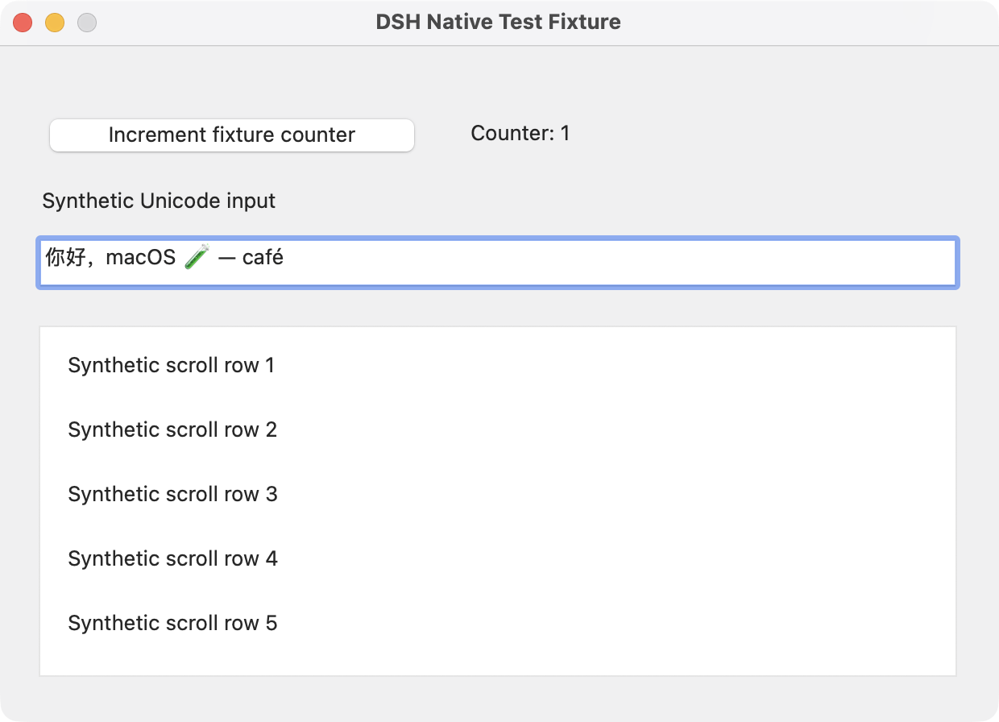

# Validation report

Updated: 2026-11-09 (Asia/Shanghai); baseline checks were first run on 2026-11-06. Adapter tests, real browser tests, native-helper tests and Host/model loading are separate evidence levels.

## 0.1.1 verification

- TypeScript, build and **44 Node tests** passed on 2026-11-09, with 0 failures and 0 skips. Includes actual isolated Chrome and Host-route tests.
- The official native helper completed **12 owned AppKit fixture checks** again on 2026-11-09. See the native section for exact scope and HTML limitations.
- The Desktop 0.2.2-rc.1 application installed and enabled the candidate tarball; all four components were running. After a restart, a new PTC conversation returned `packageVersion: 0.1.1` and `browserConfigured: true`.
- Actual Desktop/model calls used `computer_use_bootstrap` and the installed bridge through `computer_browser`. The synthetic page's AX state was read, its named input filled with Chinese text, its named button clicked, and its output read back. A separate HTTP read confirmed the same value and exactly one click.
- The same real Host/model route produced an admitted **1200 × 819 PNG**, with no Base64 printed and no second upload. The owned test tab was closed in `finally`.
- A second independent Desktop conversation created and closed an `about:blank` tab successfully after the first became idle. The initial run exposed a `BROWSER_BUSY` regression; after the idle-release fix both the DOM workflow and the second-conversation check passed. Automated regression also checks retained tabs, temporary-tab cleanup, resuming the first Agent, and old-reference rejection across connection generations.
- Both native system permission flags were true; the desktop was unlocked. Locking had blocked an earlier GUI attempt and was never counted as a pass.
- Launcher syntax, repeated-start recognition, foreign-profile refusal and invalid-directory refusal passed.

The corrected runtime passed a fresh production-only tarball installation with scripts disabled and no TypeScript installed. All public exports and installed bootstrap URLs imported, the idle-release API was present, packaged runtime bytes matched the tested build, the launcher retained executable mode, and `publint` passed. The final documentation-only repack is checked against the same runtime bytes. Personal profiles, credentials and raw session transcripts are not published.

The sections below retain the original 0.1.0 baseline details where applicable.

## Environment

- macOS 26.6.1, Apple Silicon
- Node.js 24.13.0; Playwright 1.65.0
- DeepSeek Harness and official CUA/macOS provider: 0.2.2-rc.1
- Existing Apple Swift 5.8.1 builds only the owned AppKit fixture; the official Swift 6 helper is precompiled.
- Gatekeeper `spctl --assess --type execute` passed. Official helper signature validated with `codesign --verify --deep --strict` in a non-cloud temporary directory. Documents File Provider metadata initially caused strict verification to reject the extracted `.app`; copying unchanged file contents and permissions to a local temporary directory, without the extra Finder metadata, verified successfully. No re-signing or Gatekeeper disabling was performed.

## 0.1.0 baseline commands and results

| Check | Result | What it establishes |
| --- | --- | --- |
| `npm run check` | Pass: TypeScript, 41 Node test cases, build; 0 skips | Argument mapping, freshness, browser ownership and cancellation, real CDP and Host-declarative browser route |
| `npm exec --package=publint -- publint` | Pass | Package entry/type/export hygiene |
| Harness `dsh plugin ... add link:...` and `--dump-config` | Pass in an isolated matching-version profile | Bundle composition and engine compatibility |
| Actual headless PTC model call | Pass: `HARNESS_PLUGIN_OK`, `platform: macos`, both permission flags true | Real `computer_use_bootstrap` → installed module import → current `tools.cua` → native capabilities |
| Native owned-window smoke | Pass: 12 checks | Actual AX/coordinate button effects, Unicode values and focused keyboard input, literal selection, plain/HTML-fragment paste with clipboard restoration, stale snapshot rejection, PNG and scroll offset |
| Production-only tarball installation/import | Pass: clean prefix, `--omit=dev --ignore-scripts`, root and all bridge/library exports, installed bootstrap URLs | Runtime imports work without the source checkout or dev dependencies |

The headless test profile explicitly enabled the PTC executor and credentials store; its template normally disables them. It registered CUA globally (`agentPreset:false`) only because that standalone profile has no preset registry. The shipped bundle retains the documented `agentPreset:ptc`. That initial headless check did not modify a daily Desktop profile. The later 0.1.1 Desktop checks above used the normally installed application.

## Real browser coverage

The tests start owned headless Chrome with a fresh temporary profile and a local HTTP fixture. They verify actual DOM values and counters, not only dispatched flags:

- Structured DOM snapshots and password-value redaction in that snapshot.
- Semantic fill/click, stale numeric index rejection and fresh observations.
- PNG capture, screenshot bounds and oversized capture rejection.
- Back/forward including BFCache, explicit URL/tab selection.
- Existing-tab close refusal; temporary-tab cleanup; retained/handoff pages and external browser process survive detach.
- Host locator allowlist rejects executable requests.
- Host screenshot projection maps model pixels back to CSS pixels; resize, explicit navigation and re-selection invalidate old coordinates.
- Locator waits obey the Host timeout, including omitted timeouts; zero/unlimited and larger client budgets are rejected.
- Cancellation settles a pending locator and cleans only owned resources.

The automated Host screenshot tests use a controlled admission seam. The additional 0.1.1 Desktop check above exercised actual model-aware attachment admission; it does not audit provider billing.

## Native controlled fixture

Run manually with the official helper and user-granted permissions:

```sh
npm run test:native -- --helper '/absolute/DSH Computer Use.app/Contents/MacOS/dsh-cua-native' --artifacts /private/path/to/test-results
```

Missing permissions or a locked desktop produce **blocked / exit 77**, never pass. The script owns its AppKit process and writes synthetic state independently of helper replies. Its window screenshot contains only the synthetic fixture.

The 12 checks include fixture compilation, AX tree, AX-button counter, obsolete-snapshot rejection, Unicode value/readback, scoped PNG geometry, coordinate-button counter, focused Cmd+A/Unicode typing, emoji selection/UTF-16 range, plain paste/restoration, HTML-fragment paste/restoration and changed scroll offset. Clipboard verification compares all representation/type digests in the owned fixture without writing clipboard contents.

Keyboard/paste tests explicitly activate the owned fixture first. The passing HTML input uses numeric Unicode character references. Earlier raw Unicode fragments produced AppKit encoding corruption, and a complete HTML document did not complete input in that NSTextField. General Unicode/rich-HTML compatibility is **not** established; use plain text or test an encoded fragment against the intended control.



Native direct-helper testing is not an end-to-end test of Harness's application-consent UI or revocation across multiple processes. No private desktop screenshot, user clipboard content, account credential, session log, or browser profile is published.

## Limits of validation

- Tested on Apple Silicon only; an Intel helper is provided upstream but not executed here.
- No multi-monitor/Spaces/Stage Manager qualification or locked-desktop support.
- Arbitrary third-party app controls, exceptional clipboard representations, every secondary AX action, pointer hover/holds, dragging and drag cancellation need app-specific testing.
- First-run consent/revocation UI and browser site permissions are not certified by these tests.
- Older 0.2.1-rc.5 Desktop installations are not a tested target. Use the documented matching runtime.
